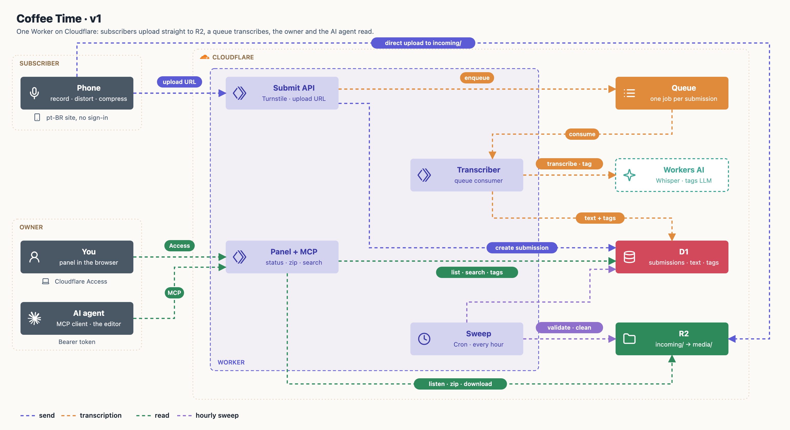

# Architecture

Coffee Time is a Portuguese-language site where subscribers send the owner a short audio or video message (plus optional photos) to be played in his vlogs. The owner listens, tags and downloads the messages in a panel; his AI agent (the video editor) reads them through MCP.



One Cloudflare Worker, near-zero cost. Main flows, one map each: [docs/flows.md](docs/flows.md). Screens: [docs/design/](docs/design/). Product scope: [docs/PRD.md](docs/PRD.md).

## Services

| Service | Role | Decision |
|---|---|---|
| **Workers** | One Worker: public site (pt-BR), submit API, panel, MCP endpoint, queue consumer, hourly cron | [ADR 0001](docs/adr/0001-one-cloudflare-worker.md) |
| **R2** | Media. Uploads go straight from the browser to `incoming/` with signed URLs; validated files move to `media/` | [ADR 0002](docs/adr/0002-direct-upload-with-quarantine.md) |
| **D1** | Submissions, status, consent, transcript, tags | [ADR 0001](docs/adr/0001-one-cloudflare-worker.md) |
| **Queues** | One job per submission: transcribe and tag in the background | [ADR 0004](docs/adr/0004-transcription-and-free-tags.md) |
| **Workers AI** | Whisper for the transcript, a text model for free-form tags | [ADR 0004](docs/adr/0004-transcription-and-free-tags.md) |
| **Cron Triggers** | Hourly sweep: finishes unconfirmed sends, deletes abandoned drafts (24 h) and failed sends (7 days) | [ADR 0002](docs/adr/0002-direct-upload-with-quarantine.md) |
| **Access** | Panel sign-in, owner's e-mail only | [ADR 0006](docs/adr/0006-panel-access-and-mcp-token.md) |
| **Turnstile** | Bot check on the public form | [ADR 0002](docs/adr/0002-direct-upload-with-quarantine.md) |

Not used: KV (nothing to cache), Durable Objects (no real time), Pages (the Worker serves the site), Stream (compression happens in the browser).

## Rules that hold everywhere

- **The browser does the heavy work** ([ADR 0003](docs/adr/0003-processing-in-the-browser.md)): compression (video 1080p ~5 Mbps, photos WebP ~2000 px), voice distortion for anonymous audio, audio-track extraction for video. The original anonymous voice never leaves the device.
- **Upload starts when the file is picked**, as a draft; nothing is processed server-side before **Send** (with consent).
- **Nothing is accepted without a server check**: size from `HEAD`, real type from the first 4 KB (magic bytes), in `incoming/` only.
- **No subscriber accounts.** Name is optional; no LinkedIn. Deletion is by e-mail to `contato@yudiganeko.com` ([ADR 0005](docs/adr/0005-no-accounts-deletion-by-email.md)).
- **Limits**: one audio *or* one video (≤ 90 s), up to 10 photos, rate limit per IP.
- **Cost**: US$ 0 until ~10 GB of media (~200 videos), then ~US$ 0.015/GB/month.

## Code layout (planned)

```
src/
  site/        public pages (pt-BR) and browser-side processing
  api/         submit API: drafts, signed URLs, complete
  panel/       owner panel (behind Access)
  mcp/         MCP endpoint (Bearer token)
  jobs/        queue consumer (transcribe + tag) and hourly sweep
  db/          D1 schema and migrations
docs/
  architecture/  draw.py, draw_flows.py, maps (svg/png)
  design/        approved screens
  adr/           decisions
```

Redraw the maps with `python3 docs/architecture/draw_flows.py` (also redraws `v1`).
