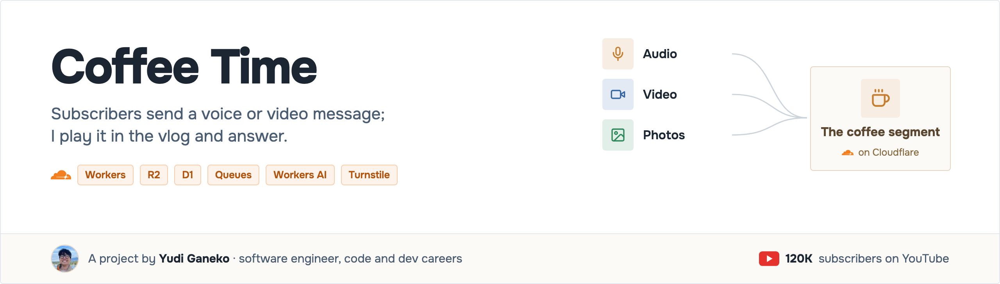
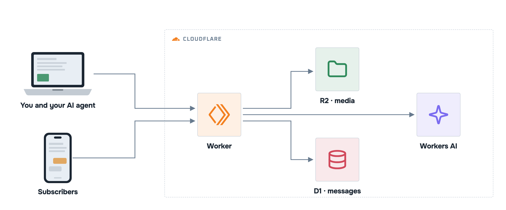
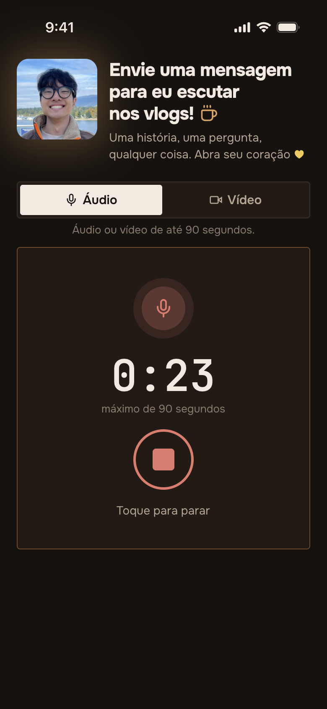
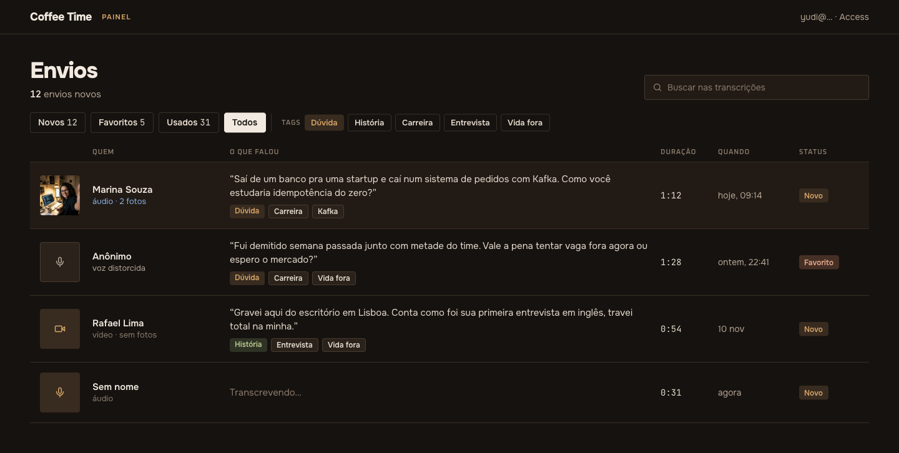

    

**A site where subscribers send a short voice or video message to be played in the vlog's coffee segment.** No account, optional voice anonymization, transcripts and tags generated in the background, and a panel plus an MCP endpoint so an AI editor can pick the messages.

Details in <a href="ARCHITECTURE.md">ARCHITECTURE.md</a>.

## Screens

  

## Links

[Architecture](ARCHITECTURE.md) · [Decisions (ADRs)](docs/adr/) · [PRD](docs/PRD.md) · [Flows](ARCHITECTURE.md#flows) · [Design](docs/design/) · [Changelog](CHANGELOG.md) · [Contributing](CONTRIBUTING.md) · [Security](SECURITY.md) · [MIT license](LICENSE)
