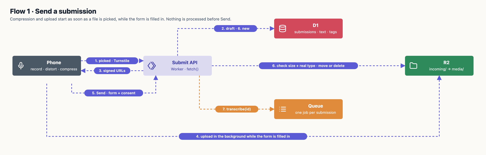
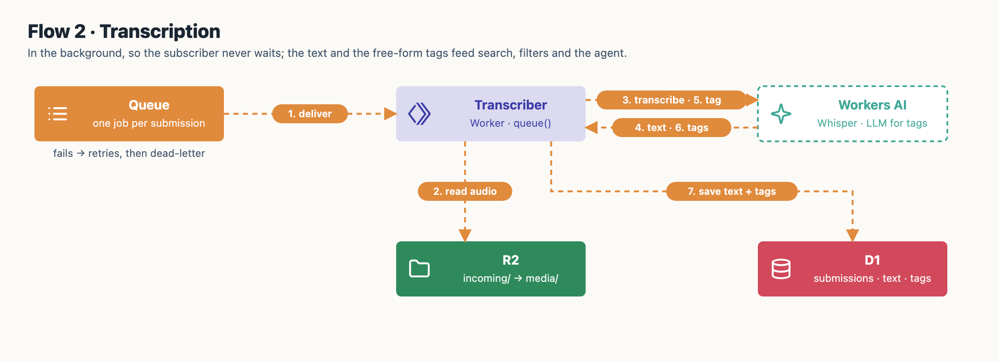
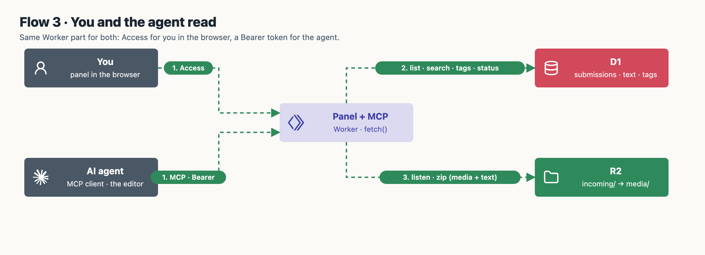
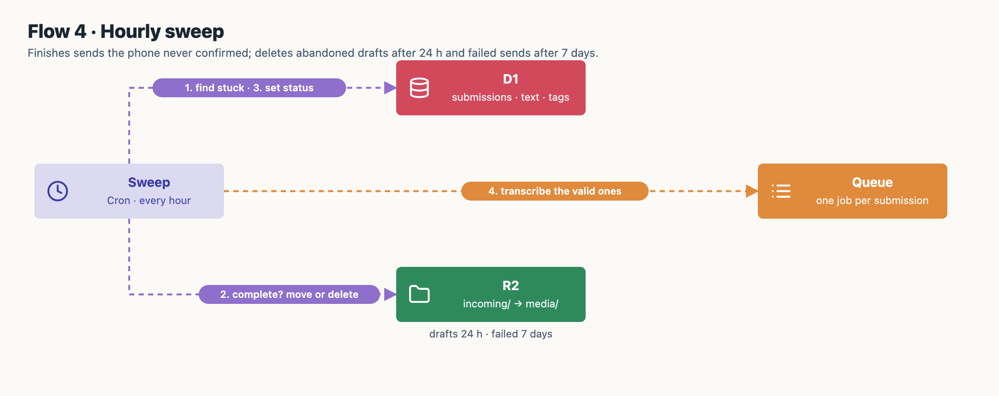
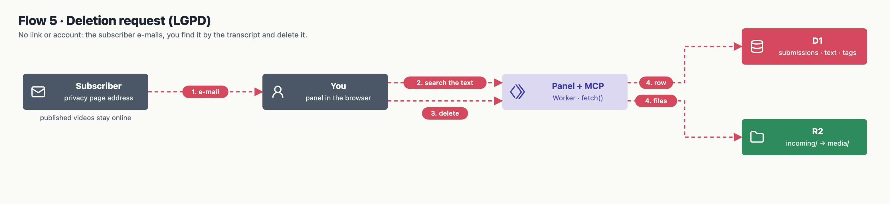

# Main flows

One map per flow, drawn by [`architecture/draw_flows.py`](architecture/draw_flows.py) in the same style as the [architecture map](architecture/v1.png). Numbers on the arrows give the order.

